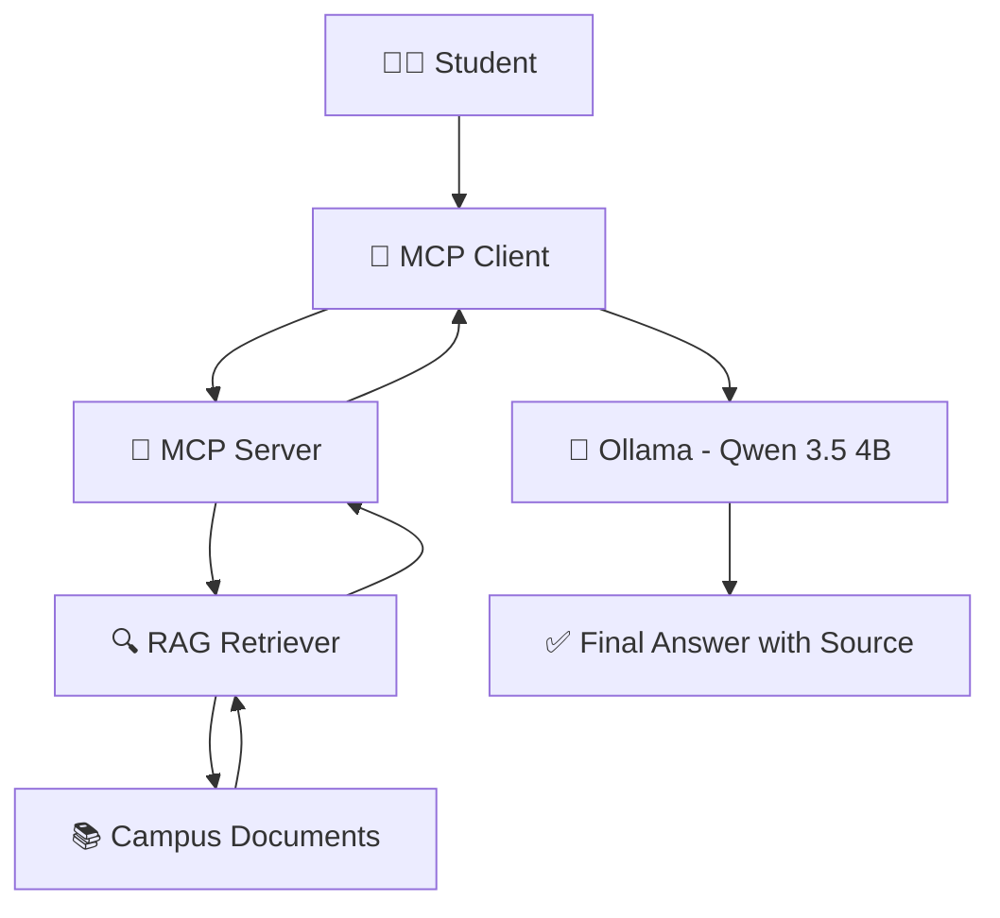
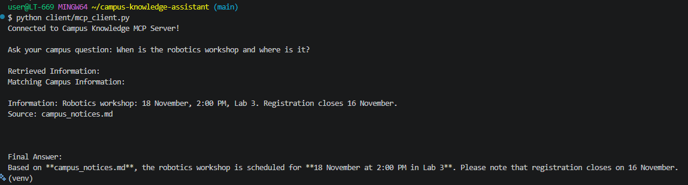

<div align="center">

# 🎓 Campus Knowledge Assistant

### Your Campus. Your Questions. Instant Answers.

An AI-powered campus information assistant that retrieves accurate information from campus documents using **RAG, Model Context Protocol (MCP), and Ollama**.

<br/>


</div>

---

## 📌 About The Project

Finding campus information often requires students to search through multiple notices, documents, and announcements.

**Campus Knowledge Assistant** solves this problem by allowing students to ask questions in natural language and receive relevant answers instantly.

The system retrieves information from campus documents using a Retrieval-Augmented Generation (RAG) pipeline, exposes retrieval functionality through a custom MCP server, and uses a locally running Large Language Model (LLM) through Ollama to generate responses.

Unlike a general-purpose chatbot, this assistant is designed to answer questions using the available campus knowledge base.

## 🎯 Problem Statement

Students frequently face difficulty finding information about:

- Campus events and workshops.
- Library and cafeteria timings.
- Campus facilities and support services.
- Important announcements and notices.

Searching through multiple documents can be time-consuming.

**Our Solution:** A centralized AI-powered assistant that retrieves relevant campus information and provides context-based answers through a simple conversational interface.

---

## ✨ Key Features

| Feature | Description |
|---|---|
| 🔍 Intelligent Retrieval | Uses TF-IDF and cosine similarity to retrieve relevant information. |
| 🤖 AI-Powered Responses | Generates natural-language answers using a local LLM. |
| 🔗 MCP Integration | Connects the AI client with a custom campus knowledge server. |
| 📚 Source Attribution | Identifies the source document for retrieved information. |
| 🛡️ Grounded Responses | Restricts answers to the retrieved campus information. |
| 🔒 Local Execution | Uses Ollama locally without requiring an external AI API. |
| ❌ Unknown Query Handling | Avoids inventing answers when information is unavailable. |

---

## 🏗️ System Architecture

The project follows a modular architecture consisting of three major components.



### 🔄 Workflow Explanation

**1. User Query**

The student enters a question through the command-line interface.

**2. MCP Client**

The client establishes a connection with the custom MCP server.

**3. MCP Server**

The server exposes a read-only tool:

`search_campus_knowledge(question)`

**4. RAG Retriever**

The retriever:
- Loads campus Markdown documents.
- Converts document text into TF-IDF vectors.
- Calculates cosine similarity between the question and documents.
- Returns the most relevant information along with source filenames.

**5. Local LLM**

The retrieved evidence is passed to the Qwen 3.5 4B model running through Ollama.

**6. Final Response**

The model generates a natural-language answer based only on the retrieved evidence and identifies the source document.

---

## 🛠️ Technology Stack

| Technology | Purpose |
|---|---|
| Python | Core programming language |
| Scikit-learn | TF-IDF and cosine similarity |
| RAG | Retrieval-Augmented Generation |
| MCP | Communication between client and server |
| Ollama | Local LLM execution |
| Qwen 3.5 4B | Natural-language answer generation |
| Markdown | Campus knowledge storage |
| Git & GitHub | Version control and project hosting |

---

## 📂 Project Structure

```text
campus-knowledge-assistant/
│
├── data/
│   ├── campus_services.md
│   └── campus_notices.md
│
├── rag/
│   └── retriever.py
│
├── server/
│   └── mcp_server.py
│
├── client/
│   └── mcp_client.py
│
├── venv/
│
├── requirements.txt
│
└── README.md
```

### 📁 Module Description

- **data/** – Contains campus services, notices, and announcements.
- **rag/** – Implements document loading and information retrieval.
- **server/** – Implements the custom MCP server and retrieval tool.
- **client/** – Connects to the MCP server and communicates with Ollama.
- **requirements.txt** – Lists Python dependencies.

---

## ⚙️ Installation and Setup

### Prerequisites

Make sure you have installed:

- Python 3.10 or later.
- Git.
- Ollama.
- Visual Studio Code (recommended).

### 1. Clone the Repository

```bash
git clone <https://github.com/Smruthi0508/Campus-Knowledge-Assistant>
cd campus-knowledge-assistant
```

### 2. Create a Virtual Environment

```bash
python -m venv venv
```

Activate it on Windows Git Bash:

```bash
source venv/Scripts/activate
```

### 3. Install Dependencies

```bash
pip install -r requirements.txt
```

### 4. Install and Configure Ollama

Download Ollama:

https://ollama.com/

Pull the model:

```bash
ollama pull qwen3.5:4b
```

Make sure the Ollama application is running before starting the assistant.

### 5. Run the Application

From the main project directory, execute:

```bash
python client/mcp_client.py
```

Enter your campus-related question when prompted.

---

## 💻 Sample Interaction
### 📸 Project Demo



### Example 1: Known Question

**Input:**

```text
Ask your campus question:
When is the robotics workshop and where is it?
```

**Retrieved Information:**

```text
Information:
Robotics workshop: 18 November, 2:00 PM, Lab 3.
Registration closes 16 November.

Source: campus_notices.md
```

**AI-Generated Answer:**

```text
The robotics workshop is scheduled for
18 November at 2:00 PM in Lab 3.

Source: campus_notices.md
```

### Example 2: Unknown Question

**Input:**

```text
What is the exam timetable?
```

**Output:**

```text
Sorry, I couldn't find this information
in the campus documents.
```

The assistant does not invent information when the knowledge base does not contain a relevant answer.

---

## 🔐 Design Principles

- **Accuracy:** Answers are grounded in retrieved campus information.
- **Transparency:** Source filenames are included with the retrieved evidence.
- **Modularity:** Retrieval, MCP server, and client are implemented separately.
- **Privacy:** The language model runs locally through Ollama.
- **Reliability:** Unknown queries are handled without fabricating information.

---

## 🚀 Future Enhancements

- Develop a web-based chatbot interface.
- Support PDF and DOCX document retrieval.
- Implement semantic search using embedding models.
- Add an administrative interface to upload campus notices.
- Expand the knowledge base with additional campus information.
- Add conversation history and multi-turn question answering.

---

## 👩‍💻 Author

**Smruthi Nagesh Hegde**

Artificial Intelligence and Data Science Engineering Student

[](https://github.com/Smruthi0508)

---

<div align="center">

### ⭐ Campus Knowledge Assistant

**Making campus information accessible through AI.**

</div>
